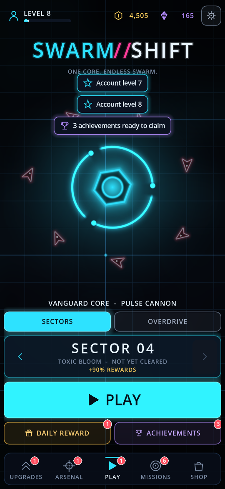
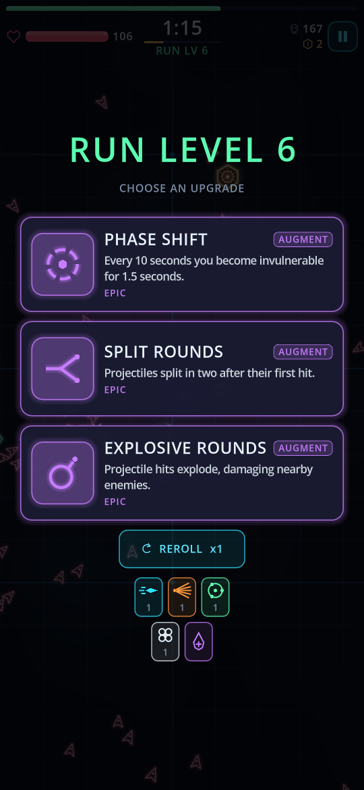
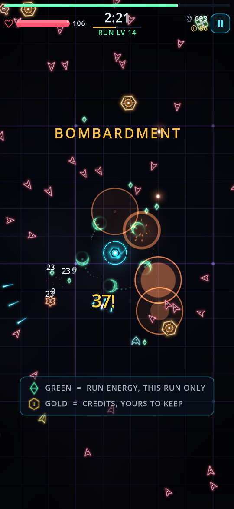
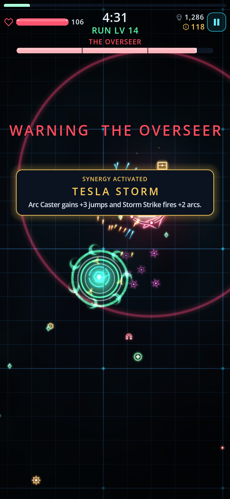

# SWARM//SHIFT

A portrait, one-thumb roguelite swarm survivor for iOS and Android. Drag to move, weapons fire on their own, collect energy, pick one of three upgrades, survive to the boss.

| Home | Level-up | Sector 3 | Boss |
| --- | --- | --- | --- |
|  |  |  |  |

More in [docs/screenshots](docs/screenshots). They are produced by the screenshot tour described below, so they can be regenerated after any visual change.

Built with **Godot 4.7.2** and GDScript. No backend, no third-party SDKs yet - ads, purchases and analytics run through mock providers behind interfaces.

- [GAME_DESIGN.md](GAME_DESIGN.md) - what the game is and how it is tuned
- [ARCHITECTURE.md](ARCHITECTURE.md) - how the code is organised, how to extend it, and what must happen before real money is switched on
- [APP_STORE_READINESS.md](APP_STORE_READINESS.md) - commercial release audit: what stands between this build and the App Store
- [docs/playtest-1](docs/playtest-1/README.md) - the freeze found in the first device playtest: cause, evidence and fix
- [docs/playtest-2](docs/playtest-2/README.md) - pickups that stopped appearing in big fights, and the "maxed upgrade" card report
- [docs/playtest-3](docs/playtest-3/README.md) - enemy shots lost in the swarm, and the Prism Lance and Plasma Mines rework, with the weapon measurements

## Requirements

| Tool | Notes |
| --- | --- |
| Godot 4.7.2 | `brew install --cask godot` |
| Export templates 4.7.2 | Installed to `~/Library/Application Support/Godot/export_templates/4.7.2.stable/` |
| Xcode | For iOS device builds; signed in to the team in `export_presets.cfg` |
| Android SDK + JDK 17 | Only needed to export Android; not set up yet |
| AdMob bridge | Built by `tools/build_admob.sh` (downloads pinned, checksum-verified Google SDKs and godot-cpp into `build/deps`); `tools/ios_deploy.sh` runs it the first time. See [native/admob](native/admob/README.md) |

## Run it

```bash
godot --path .
```

Opens a phone-shaped window. Mouse drag stands in for a thumb; WASD / arrow keys also move. Escape is the Android back button.

Useful launch options (everything after `--`):

| Option | Effect |
| --- | --- |
| `--play` | Skip the menu, start a run |
| `--autoplay` | Let the built-in bot play (attract mode / soak test) |
| `--perf` | Frame-time, entity-count and run-diagnostics overlay in a run |
| `--seed=N` | Reproducible run |
| `--log-analytics` | Print every analytics event |
| `--profile=<name>` | Play on a separate save file, leaving the real profile alone |
| `--snap=<file.png>` | Save a screenshot after `--snap-after` seconds (default 3) and quit |

Open the project in the editor with `godot --path . --editor`.

## Test it

```bash
godot --headless --path . --import          # once after adding files
godot --headless --path . -- --test
```

160 tests, about 2,810 checks, two to three minutes (most of it the stability suite).

| Suite | Covers |
| --- | --- |
| `scripts` | Every script compiles |
| `data` | Tables load and cross-reference; every blast gives enough warning to walk out of |
| `services` | Save, economy, missions, achievements, ads and store policy |
| `upgrades` | Upgrade cards: a person-like player picking and rerolling at random over six runs, maxed weapons and passives never offered, over-cap and stale cards refused, a full build still dealt a fair hand, pause during a choice |
| `combat` | Enemy fire drawn on top at its true hit size, every shot visible in a dense fight, Shooter firing cue; Prism Lance aiming, piercing and level scaling; Plasma Mines placement, trigger radius, arming and slowing; damage and kill attribution; load; old saves with both weapons |
| `shake` | Camera shake: one subtle shake for a chain of hundreds of exploding enemies, none for ordinary explosions or weapon fire, no request can extend a shake, big moments still land, and the Off / Low / Normal setting |
| `pickups` | Rewards on the floor: hundreds of deaths in one step, a saturated field, merging that keeps energy and Credits apart and exact, collection after merging, explosions, long heavy runs |
| `ads` | AdMob provider and consent flow against a scripted stand-in for the native bridge: consent timing, preloading, retries, rewards only on the reward callback, timeouts |
| `gameplay` | Whole runs played by the bot, every weapon, the boss, determinism |
| `ui` | Every screen builds; real synthetic taps and drags; the lobby, upgrades, pause and results flows |
| `progression` | Player Level, Credits, banking exactly once, recovery of an interrupted run, permanent upgrades, and a save from before those features |
| `threats` | What each sector contains, mutators, and that Mortars, Bombers and bombardments can always be avoided |
| `stability` | The playtest-1 freeze, HUD recovery, multi-touch, and overload: 1,000 enemies, hundreds of explosions, a long Overdrive soak |

Run one suite or one test:

```bash
godot --headless --path . -- --test=gameplay --only=boss --trace
```

The soak test simulates ten minutes of Overdrive by default; ask for longer with `--soak`:

```bash
godot --headless --path . -- --test=stability --only=long_session --soak=30
```

The stability suite asserts on step times, so run it on an otherwise idle machine.

## Balance and performance tools

```bash
# 20 bot runs of sector 4 with 30% of permanent upgrades bought
godot --headless --path . -- --sim=20 --sector=4 --meta=0.3 --skill=0.6

# Per-30-second trace of one run
godot --headless --path . -- --sim=1 --timeline

# Minute-by-minute pressure: hits taken, enemies, speed, charges, shots, blast zones
godot --headless --path . -- --sim=30 --sector=2 --meta=0.15 --pressure

# Worst-case load with a per-system time breakdown
godot --headless --path . -- --bench

# Every weapon alone at levels 1, 3 and 5: one tough target, a swarm on a still
# player, a swarm chasing a moving one (deterministic; about two minutes)
godot --headless --path . -- --weapon-bench

# Full runs where each weapon is the only one the run can have
godot --headless --path . -- --weapons=8 --sector=2 --meta=0.15

# A free player's campaign on one profile: play, bank, buy the cheapest upgrade, repeat
godot --headless --path . -- --campaign=8 --skill=0.6

# Screenshot of every screen (needs a window)
godot --path . --resolution 540x1170 -- --shots=/absolute/output/folder
```

All balance values live in `data/*.json`. Change a number, re-run the simulation, compare. Every simulation also reports the average Credits and Player XP a run pays, and how often an upgrade screen opens within a moment of the previous one closing.

## When something goes wrong on a device

The game writes a local event log and flushes it whenever the app loses focus, so the last events before a crash or freeze survive it. Pull it from a connected iPhone without disturbing the app:

```bash
xcrun devicectl device copy from --device <udid> --domain-type appDataContainer --domain-identifier com.starscale.swarmshift --source Documents/analytics.jsonl --destination analytics.jsonl
```

Each line is one event with the run time it happened at. A `hud_recovered` event means the interface found itself out of step with the run and repaired it - worth a bug report even though the player was not stuck. A run that was cut short is paid out at the next launch, with a dialog saying so.

## Regenerate art and audio

Every sprite and sound is generated by a script and written as a plain file, so any of them can be replaced by hand-made assets with the same file name.

```bash
godot --headless --path . --script res://tools/generate_art.gd
godot --headless --path . --script res://tools/generate_audio.gd
godot --headless --path . --import
```

## Build for iOS

The fastest route to a phone is the deploy script. Connect an iPhone (trusted, unlocked, Developer Mode on) and run:

```bash
tools/ios_deploy.sh
```

It exports the Xcode project from Godot, builds and signs it, installs it over any copy already on the phone (save data is kept) and launches it. Variants:

```bash
tools/ios_deploy.sh --no-launch
```

```bash
tools/ios_deploy.sh --check
```

`--check` runs the on-device self-test described below and prints its report.

Signing is configured in `export_presets.cfg`, which is the source of truth - the Xcode project under `build/ios` is regenerated on every export, so changes made by hand in Xcode are lost:

| Setting | Value |
| --- | --- |
| Team | `8RGSL8W378` (STARSCALE LTD) |
| Bundle identifier | `com.starscale.swarmshift` |
| Signing | Automatic, Apple Development certificate |
| Devices | iPhone and iPad, portrait only, iOS 15+, A12 chip or newer |

The script uses the development certificate and provisioning profile Xcode already holds and makes no changes to the Apple developer account. If a profile is missing or a new device needs registering, run it as `ALLOW_PROVISIONING=1 tools/ios_deploy.sh`, or open `build/ios/SwarmShift.xcodeproj` in Xcode once.

To do it by hand:

```bash
godot --headless --path . --export-debug "iOS" build/ios/SwarmShift.ipa
open build/ios/SwarmShift.xcodeproj
```

### AdMob bridge

The Google Mobile Ads + consent SDKs are reached through a small native extension, `AdMob`, documented in [native/admob/README.md](native/admob/README.md). Every build uses Google's sample app id and test ad units (`admob` in `data/monetization.json`), so only test ads can appear. On an iPhone build the game's ads go through `AdMobAdProvider`: Google's consent check at every launch, the consent form (and Apple's tracking prompt) at the first quiet moment after the player's first run, then real test ads in every placement. The desktop, tests and simulations keep the mock provider. To see the consent form again on a phone that has already answered, launch with `--consent-reset`. To walk the bridge on its own through the consent form and two test ads (someone has to tap through them):

```bash
tools/ios_deploy.sh --admob-check
```

### Privacy, support and licences

Settings has rows for the privacy policy, support, reporting an ad, Google's privacy choices (shown only when the consent SDK requires it) and third-party licences. The three web links live in `links` in `data/game.json` and are **placeholders on example.com** until C2's pages exist; swap them in there and in App Store Connect. The licences screen is generated from the engine binary plus `third_party` in the same file.

### On-device self-test

Launching the installed app with `--device-check` makes it report on what only real hardware can show: screen size and safe-area insets, renderer, audio, file storage, touch routing, and frame rate while a bot plays under load. It writes `device_check.txt` to the app's Documents folder and never modifies the player's profile.

```bash
xcrun devicectl device process launch --console --terminate-existing --device <udid> com.starscale.swarmshift -- --device-check
xcrun devicectl device copy from --device <udid> --domain-type appDataContainer --domain-identifier com.starscale.swarmshift --source Documents/device_check.txt --destination device_check.txt
```

Last result (iPhone 16 Pro Max, iOS 27.0, debug build): Metal renderer, 1320x2868, 120 fps average and in the slowest second with about 240 enemies on screen, 24 checks passed. The full report is in [docs/iphone_16_pro_max_self_test.txt](docs/iphone_16_pro_max_self_test.txt).

Things to know:

- **Sound follows the Ring/Silent switch.** The game uses iOS's "ambient" audio session, so it is muted in silent mode and plays alongside the user's own music. Change `audio/general/ios/session_category` in the project settings if you want otherwise.
- **The engine's own log output is not forwarded** by `devicectl --console`; only the report file is reliable.
- **A line reading `Could not vibrate using haptic engine: (null)`** in the device log is printed by the engine on every successful vibration. `(null)` means no error.
- **The iOS Simulator is not supported** by Godot's official export template on Apple silicon (its simulator library is x86_64-only). Test on a device.
- **Before the App Store:** this is a debug build signed for development. A store build needs a release export, a distribution certificate and the checklist in [ARCHITECTURE.md](ARCHITECTURE.md).

## Build for Android

Install Android Studio (SDK, build-tools) and JDK 17, point Godot at them in *Editor Settings > Export > Android*, then:

```bash
godot --headless --path . --export-debug "Android" build/android/SwarmShift.apk
```

The preset already sets the package name, portrait immersive mode and the vibrate permission.

## Renaming the game

The working title appears in three places:

1. `data/game.json` -> `title` and `tagline` (everything shown in-game)
2. `project.godot` -> `application/config/name` (the name under the app icon)
3. `export_presets.cfg` -> bundle identifier / package name, and the export file names

The iOS bundle identifier is `com.starscale.swarmshift`. The Android package name is still the original placeholder, `com.c2gaming.swarmshift`; align it before the first Android build if the two should match.

No code refers to the title directly.

## Project layout

```
data/        Balance and content tables (JSON)
assets/      Generated sprites, audio, shaders, app icon
src/app      Composition root (the only autoload), the game shell, on-device checks
src/core     Data loading, formatting
src/services Save, economy, progression, missions, ads, store, analytics, audio
src/game     The run: arena, enemies, weapons, boss, effects
src/ui       Design system, HUD, menu screens
tools/       Art and audio generators, iOS deploy script, AdMob bridge build
native/      Native code: the AdMob bridge GDExtension (ignored by the engine)
addons/      AdMob export plugin; the built bridge lands here (git-ignored)
tests/       Test suites, balance simulator, screenshot tour
docs/        Reference screenshots and the playtest-1 investigation (ignored by the engine)
build/       Export output (ignored by git)
```
